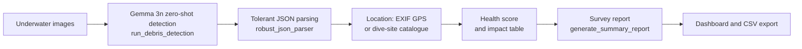

# gemma3n-oceanguard

Prototype that uses the multimodal [Gemma 3n](https://ai.google.dev/gemma) model (4-bit, via
[Unsloth](https://github.com/unslothai/unsloth)) to detect and count marine debris in underwater images and to
turn the detections into geolocated survey reports. It was built as a proof of concept for a language-model-based
alternative to the dedicated detectors used in the rest of the OceanguardAI project.

The model is used zero-shot: there is no fine-tuning in this repository, and its detections are not comparable
in accuracy to the trained detectors (RT-DETRv2, RF-DETR, DiffusionDet).

## Contents

```
app/                    Streamlit application
  main.py               Entry point (upload, analysis, dashboard, reports)
  gemma_handler.py      Model loading, detection prompt, report generation
  ui_components.py      Maps, charts and per-image panels
  utils.py              EXIF GPS extraction, health score, tolerant JSON parsing
  config.py             Prompts, debris impact table, dive-site catalogue
scripts/
  inference_gemma.py    Command-line detection / counting
  evaluate_performance.py   Detection and classification evaluation on a COCO-format dataset
```

## Pipeline



## Features

- Detection of debris items with class, material, confidence and normalized bounding box, returned as JSON.
- Tolerant parsing of the model output (extra text, missing commas between objects).
- GPS coordinates read from EXIF metadata; images without GPS get a location from a small catalogue of dive
  sites (`app/config.py`).
- Per-location ecosystem health score and impact table (degradation time and risk per debris type).
- Survey reports generated by the model in six languages (EN, ES, FR, DE, IT, PT) and CSV export.

## Installation

Requirements: Python 3.10+, an NVIDIA GPU with CUDA 12.8, and access to the
`unsloth/gemma-3n-e2b-it` weights on Hugging Face (accept the Gemma terms of use first).

```bash
git clone https://github.com/asferrer/gemma3n-oceanguard.git && cd gemma3n-oceanguard
python -m venv .venv && source .venv/bin/activate
pip install torch==2.7.1 torchvision==0.22.1 --index-url https://download.pytorch.org/whl/cu128
pip install -r requirements.txt
```

## Usage

Streamlit application:

```bash
streamlit run app/main.py
```

Command-line inference:

```bash
python scripts/inference_gemma.py --mode detect --path image.jpg   # writes image_analyzed.jpg
python scripts/inference_gemma.py --mode count  --path img1.jpg img2.jpg
```

Evaluation on a COCO-format dataset (images in one folder, one annotation file):

```bash
EVAL_IMAGE_DIR=path/to/images EVAL_ANNOTATION_FILE=path/to/annotations.json \
  python scripts/evaluate_performance.py --draw --report
```

The script reports per-class precision, recall and F1 at IoU 0.5 for detection, and image-level classification.

## License and third-party terms

The code is released under the Apache License 2.0 (see `LICENSE`). Gemma 3n weights are distributed under the
[Gemma Terms of Use](https://ai.google.dev/gemma/terms) and are not included here. Unsloth is licensed under
Apache-2.0 (core) and its own terms for some components; check them before redistribution.

## Citation

See `CITATION.cff`.

## Author

Alejandro Sánchez Ferrer.
